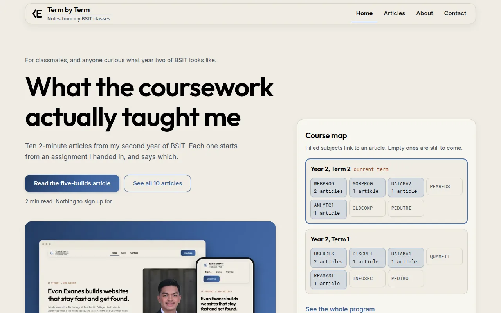

# Term by Term: WEBPROG Activity 3 blog

**A ten-article blog about my second year of BSIT, built with CSS Grid and a mobile-first layout.**

## What this shows
- A 13-page blog about second-year BSIT work, built with HTML, CSS Grid and one small menu script.
- Layouts start at 320 px, and the phone menu drawer traps focus and closes on Escape. With JavaScript off, the links stay in the header.
- Every article starts from work I handed in and says which.

## Contents
- [What this shows](#what-this-shows)
- [About](#about)
- [What the activity asked for](#what-the-activity-asked-for)
- [Design](#design)
- [Run it](#run-it)
- [License](#license)
- [Author](#author)

## About
A blog about my second year of BSIT at Asia Pacific College, built for Web Programming (WEBPROG). It has 13 pages: Home, Articles, About and ten article pages. Every article starts from work I handed in and says which.

## What the activity asked for
- **CSS Grid** for the page layouts: a 12-column grid for the Home hero, a two-column article page (text and aside), and Grid tiles for the course map.
- **Mobile friendly** from 320 px up: one column on a phone, two at tablet width, the full grid from 960 px. No sideways scrolling, 44 px tap targets, and text never smaller than 12 px.
- **Phone menu.** Below 640 px the links move into a drawer opened by a hamburger button. It traps focus, closes on Escape and returns focus to the button. With JavaScript off, the links stay in the header.

## Design
Cream canvas, black Outfit headings, hairline rules and the denim gradient used sparingly, the same system as my [portfolio](https://evanexanes.github.io/). Every image is a screenshot of my own work or a card made from numbers in the article. There is one light theme at every width, with no theme switch.

## Run it
There is no build step and no framework. Download the folder and open `index.html` in a browser. Keep `fonts/` and `images/` next to the HTML files, because the pages load them by relative path.

Outfit and Inter are bundled in `fonts/`, both under the SIL Open Font License, so the pages make no network requests. The only script is `menu.js`, the phone menu.

## License
The code and article text are released under the [MIT License](LICENSE).

## Author
**Evan Prens P. Exanes** · [GitHub](https://github.com/evanexanes) · [Portfolio](https://evanexanes.github.io/) · [Contact](https://evanexanes.github.io/07-contact.html)
